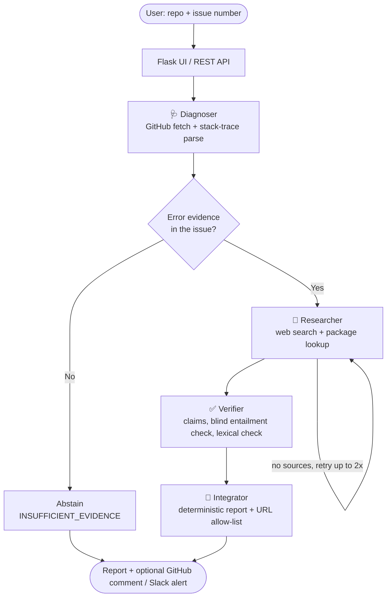

<div align="center">

# 🚀 AutoDev-Triage

### Evidence-grounded, multi-agent GitHub issue triage

*Reads a GitHub issue, researches the fix, and writes a root-cause analysis — and says **"I don't know"** when the evidence isn't there.*


[Features](#-features) · [Architecture](#-architecture) · [Quick start](#-quick-start) · [Evaluation](#-evaluation) · [Limitations](#-known-limitations)

</div>

---

## ✨ Overview

Triaging a bug report usually means: read the issue, understand the stack trace, search for known fixes, write a reply. **AutoDev-Triage automates that loop with a small team of AI agents** and then goes one step further than most LLM demos: every claim in the final report must be backed by evidence, and issues without enough evidence are *explicitly marked as such* instead of getting a confident guess.

No vector database, no RAG pipeline — just deterministic tool-calling against live APIs (GitHub, web search, PyPI/npm).

## 🎯 Features

| | |
|---|---|
| 🧠 **Multi-agent graph** | Diagnoser → Researcher → Verifier → Integrator, orchestrated as an explicit [LangGraph](https://github.com/langchain-ai/langgraph) state machine with a retry loop |
| 🛑 **Honest abstention** | A deterministic gate detects issues with no error text (feature requests, vague reports) and returns `INSUFFICIENT_EVIDENCE` instead of inventing a root cause |
| ✅ **Independent verifier** | Claims are proposed with citations, then checked by a *separate, blind* entailment call plus a lexical grounding check (versions, identifiers, error codes) |
| 🔗 **URL allow-list** | Every link in a report must come from an actual tool result or the issue itself — enforced in code, not by prompting |
| 🧾 **Deterministic report** | The final report is composed without an LLM, so the Integrator cannot introduce unsupported claims |
| 🛡️ **Validated tool calls** | Every LLM tool call is validated with Pydantic v2; validation errors are fed back so the model can self-correct |
| 📊 **Built-in benchmark** | 17 issues with known ground truth, a blind LLM judge, and a single-LLM baseline to compare against |
| 🖥️ **Mac × GitHub UI** | Dark, glassy interface with a live progress overlay, rendered report cards and one-click copy/download |
| 🔐 **Token safety** | Paste a GitHub token in the UI; it is used for that request only and never stored, logged or returned |

## 🏗️ Architecture



### Verdicts

| Verdict | Meaning |
|---|---|
| `VERIFIED` | Every root-cause and fix claim is supported by the cited evidence |
| `PARTIALLY_VERIFIED` | Root cause is supported; some other claims are flagged ⚠️ as unverified |
| `UNVERIFIED` | No root cause could be confirmed; any hypotheses are clearly labelled |
| `INSUFFICIENT_EVIDENCE` | The issue has no error text; the report asks for what's missing |

> [!NOTE]
> `VERIFIED` means *"supported by the cited evidence"*, not *"the diagnosis is complete"*.

### Tech stack

| Layer | Tools |
|---|---|
| Orchestration | LangGraph |
| LLM | OpenAI `gpt-4o-mini` (function calling, structured outputs) |
| Validation | Pydantic v2 |
| Backend / UI | Flask, vanilla JS, custom CSS |
| Integrations | GitHub REST API, Tavily web search, PyPI / npm registries, Slack webhooks |
| Testing | pytest (LLM and network fully mocked) |

## ⚡ Quick start

```bash
git clone https://github.com/YOUR_USERNAME/autodev-triage.git
cd autodev-triage
python -m venv venv
# Windows PowerShell:  .\venv\Scripts\Activate.ps1      macOS / Linux:  source venv/bin/activate
pip install -r requirements.txt
cp .env.example .env        # Windows: copy .env.example .env   -> then fill in your keys
python api/index.py         # open http://localhost:5000
```

**Environment variables**

| Variable | Required | Purpose |
|---|---|---|
| `OPENAI_API_KEY` | ✅ | LLM calls |
| `TAVILY_API_KEY` | ✅ | Web search |
| `GITHUB_TOKEN` | optional | Private repos, posting comments (or paste it in the UI) |
| `SLACK_WEBHOOK_URL` | optional | Slack alerts |

**Use it**

- **Web UI:** enter `owner/repo` and an issue number, optionally paste a GitHub token and tick *Post RCA as GitHub comment*.
- **REST API:**
  ```bash
  curl -X POST http://localhost:5000/api/triage \
    -H "Content-Type: application/json" \
    -d '{"repo": "owner/repo", "issue_number": 123}'
  ```
  The response includes `verdict`, per-claim `claims` with status, `missing_info`, the `rca_report` and an agent `trace`.

<!-- Add a screenshot or GIF, then uncomment:
## 🎬 Demo

-->

## 📊 Evaluation

The repo ships its own benchmark so claims can be checked, not just believed.

**Method**
- **Dataset:** 12 issues with known ground truth (10 real-world bugs + 2 *control* issues where the correct answer is "not enough information"), plus a separate **held-out set of 5** that was not used to design the verifier.
- **Systems compared:** a single plain LLM call (baseline), the original free-form pipeline (v1), and the evidence-grounded pipeline (v2). All use the same model, prompt and issue text.
- **Judge:** a stronger model (`gpt-4o`) scoring blind — it never sees which system wrote a report.

**Results — evidence-grounded pipeline (v2), original 12-issue set**

| Metric | Result |
|---|---|
| Root cause correct (all issues) | **92%** (11/12) |
| — on real bugs | 90% (9/10) |
| — on control issues (correct abstention) | **100%** (2/2) |
| Fix reasonable | 83% |
| Claims grounded in cited evidence | 79% |
| Reports containing ungrounded URLs | **0%** |
| Avg. latency / cost per issue | ~23 s / ~$0.0016 |

Verdicts: 5 × `VERIFIED`, 5 × `PARTIALLY_VERIFIED`, 2 × `INSUFFICIENT_EVIDENCE`. Side-by-side reports for the single-LLM baseline and the earlier pipeline version, plus the held-out set, are saved in [`evals/results/`](evals/results/).

**Reproduce** (needs your own sandbox repo and API keys; the scripts never post to GitHub except `post_test.py`):

```bash
python scripts/create_issues.py --repo YOU/sandbox           # create the benchmark issues
python scripts/run_eval.py --repo YOU/sandbox                # original 12, all systems
python scripts/run_eval.py --repo YOU/sandbox --split heldout
python scripts/make_report.py                                # rebuild markdown reports from saved JSON
```

## 🧪 Testing

```bash
pip install -r requirements-dev.txt
python -m pytest tests -q        # 55 offline tests, no API keys needed
```

Offline tests cover the stack-trace parser, Pydantic tool validation, the abstention gate, URL sanitising, claim grounding and verdict logic, the API/UI routes, token handling, and failure modes (GitHub 404s, verifier failures, posting failures).

## 🗂️ Project structure

```text
autodev-triage/
├── api/index.py            # Flask app: UI + REST API (Vercel entrypoint)
├── agents/
│   ├── diagnoser.py        # fetch issue, parse stack trace, classify
│   ├── researcher.py       # web search + package metadata
│   ├── evidence.py         # evidence ledger + error-signal gate
│   ├── verifier.py         # claim proposal + blind entailment check
│   ├── guard.py            # lexical grounding, URL sanitising, verdicts
│   ├── report.py           # deterministic report composer
│   ├── integrator.py       # report, GitHub comment, Slack alert, abstain node
│   ├── workflow.py         # LangGraph wiring (grounded + legacy modes)
│   ├── tools.py / llm.py / state.py
├── utils/                  # GitHub client, markdown helpers
├── templates/ + static/    # UI
├── evals/                  # dataset, baseline, judge, metrics, saved results
├── scripts/                # create_issues, run_eval, make_report, live tests
├── tests/                  # offline test suite
└── vercel.json
```

## ☁️ Deployment

A `vercel.json` (60 s function limit) is included. Typical runs take ~23 s, the slowest observed ~39 s.

> [!WARNING]
> A public deployment spends **your** OpenAI and Tavily credits on every request. Add rate limiting or an access code before sharing a live URL.

## ⚠️ Known limitations

Stated up front, because they matter when interpreting the numbers:

- **Small, synthetic benchmark.** 12 + 5 issues, written for this project and built around well-known errors that models have likely seen. Differences of one or two issues are within noise, and each system was run once.
- **LLM-as-judge.** Scoring is blind and uses a stronger model, but it is still an LLM; judge wording sensitivity shows up on borderline cases. One benchmark item (`keyerror-user`) has a ground truth (check the HTTP status) that the issue text itself doesn't support, and is counted as a miss.
- **Abstention rule is conservative.** The gate requires error text (a trace or exception message). A genuine bug described only in prose will be answered with `INSUFFICIENT_EVIDENCE` and a request for details.
- **Grounding ≠ completeness.** Reports are intentionally terse and contain no code snippets; `VERIFIED` means the claims are supported, not that the diagnosis is exhaustive.
- **Search snippets, not full pages.** Verification runs against search-result snippets, which can be too short to confirm a correct claim — those become `⚠️ unverified` rather than guesses.
- **Synchronous requests.** One triage blocks for ~20–40 s; there is no job queue yet.

## 🛣️ Roadmap

- [ ] Stream real agent progress to the UI (replace the timed progress overlay)
- [ ] Repeated runs + judge-agreement checks to put error bars on the benchmark
- [ ] Fetch full pages for verification instead of snippets
- [ ] Rate limiting and an async job queue for public deployment
- [ ] CI with GitHub Actions

---

<div align="center">

Built as a study in **reliable LLM systems**: tool-calling, grounding, abstention and honest evaluation.

</div>
